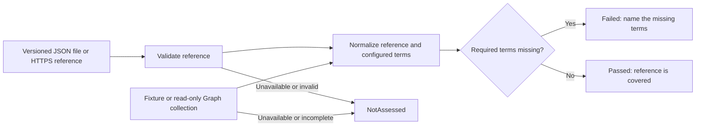

# Entra Password Blocklist Reference

[](https://github.com/FiraSenax/entra-password-blocklist/actions/workflows/test.yml)

Load a versioned reference, normalize both sets and find the required terms missing from an Entra custom banned-password list. Includes a working PowerShell demo, a curated starter reference, tests and a Pester-format Maester adapter.

**Passkeys and phishing-resistant sign-in are the direction to aim for.** This password-list check is a concrete Security as Code example for password configuration that still exists during that transition. See [Microsoft's passwordless deployment guidance](https://learn.microsoft.com/en-us/entra/identity/authentication/how-to-deploy-phishing-resistant-passwordless-authentication).



## Run it in one command

Requires PowerShell 7.2 or later. The demo needs no tenant, credentials or modules beyond PowerShell itself.

```powershell
git clone https://github.com/FiraSenax/entra-password-blocklist.git
cd entra-password-blocklist
pwsh ./examples/Compare-Demo.ps1
```

The [demo reference](references/demo.json) deliberately contains mixed case, whitespace and a duplicate:

```json
{
  "schemaVersion": 1,
  "name": "Three-term demonstration",
  "version": "1.0.0",
  "terms": [" Cedar ", "ORION", "harbor", "cedar"]
}
```

| Configured terms | Normalized terms | Result |
| --- | --- | --- |
| `CEDAR; h@rbor ;extra;cedar` | `cedar`, `extra`, `harbor` | Failed: `orion` is missing |
| `CEDAR; ORI0N ;h@rbor;extra;cedar` | `cedar`, `extra`, `harbor`, `orion` | Passed |

Extra tenant terms are allowed. Requiring an exact list match would incorrectly reject useful additions made by a tenant owner.

## Fetch the reference from GitHub

The same example works with a real HTTPS source:

```powershell
$referenceUri = 'https://raw.githubusercontent.com/FiraSenax/entra-password-blocklist/main/references/demo.json'
pwsh ./examples/Compare-Demo.ps1 -ReferenceUri $referenceUri
```

For a repeatable assessment, replace `main` with a reviewed full commit SHA or use the reference checked out with your tests. The reference's `version` identifies its declared version; the resolved commit identifies its exact contents. Fetching a file successfully does not establish that its terms are still appropriate. Review the reference and its ownership separately.

## Build your organisation's reference

The [20-term starter](references/blocklist.json) describes a **fictional Northstar organisation**. It is a curated example to fork and adapt:

| Context | Examples |
| --- | --- |
| Organisation and brand | `northstar`, `northstarit`, `northstarcloud`, `nslabs` |
| Products | `orion`, `harbor`, `cedar`, `helix`, `atlas`, `beacon` |
| Locations | `northport`, `westhaven`, `lakeside` |
| Internal services | `starlab`, `nsportal`, `nshelpdesk`, `nsonboarding`, `starconnect`, `northacademy`, `nsworkspace` |

Replace these with approved base terms from your own organisation. Microsoft already maintains a global banned-password list. The custom list adds context such as brand, product, location and internal terms. It supports up to 1,000 terms, each 4 to 16 characters long. [Microsoft's custom-list guidance](https://learn.microsoft.com/en-us/entra/identity/authentication/tutorial-configure-custom-password-protection).

Export the validated, normalized starter as one term per line:

```powershell
pwsh ./Export-Blocklist.ps1
```

This prints text for review. It does not update a tenant. Keep confidential internal terms in your own private reference rather than contributing them to this public demonstration.

## What normalization means here

Both sides use the same comparison normalization:

1. Trim surrounding whitespace and convert to invariant lower case.
2. Apply the documented substitutions `0 → o`, `1 → l`, `$ → s`, `@ → a`.
3. Remove duplicates and order the normalized set.

Invalid terms are reported as unavailable/invalid evidence rather than silently discarded. Internal spaces and punctuation are retained. Normalization is for comparing configured terms; it does not implement Microsoft's fuzzy matching, password scoring or complete password-validation algorithm. A covered reference does not guarantee that every password containing a listed term will be rejected. [Microsoft's password-evaluation explanation](https://learn.microsoft.com/en-us/entra/identity/authentication/concept-password-ban-bad).

## Use the command in automation

```powershell
pwsh ./Invoke-BlocklistCheck.ps1 `
    -ReferencePath ./references/demo.json `
    -SettingsPath ./examples/fixtures/missing-term.json
```

| Exit code | Status | Meaning |
| --- | --- | --- |
| `0` | Passed | Every required normalized reference term is present. |
| `1` | Failed | Complete evidence establishes that required terms are missing. |
| `2` | NotAssessed | Reference or tenant evidence is unavailable, invalid or incomplete. |

A known empty custom list fails against a nonempty reference. A missing or null list field is unassessed. An empty or invalid reference can never produce a pass.

## Optional: read an actual tenant

The live collector supports the commercial Microsoft Graph endpoint. It uses `GET /beta/settings` and reads `Password Rule Settings` / `BannedPasswordList`. Beta API contracts can change. This collector requires the Microsoft Graph Authentication module and an existing signed-in Global-cloud context. [API and permission requirements](https://learn.microsoft.com/en-us/graph/api/group-list-settings?view=graph-rest-beta).

```powershell
Connect-MgGraph -Scopes 'GroupSettings.Read.All'
./Invoke-BlocklistCheck.ps1 -ReferencePath ./references/blocklist.json -Live
```

The caller must have the documented delegated role/access requirements as well. Alternatively, use an existing application context with reviewed read permissions. The collector does not sign in, create an application, grant permissions or write configuration. Pagination must complete on the expected Graph host before comparison.

**Scope of a pass:** reference-list coverage only. This does not check whether custom-list enforcement is enabled, test password changes, assess passkey rollout or establish overall tenant security. Use the relevant existing Maester controls and operational checks alongside this custom requirement.

## Run the Maester adapter

[custom/PasswordReference.Tests.ps1](custom/PasswordReference.Tests.ps1) uses the same comparison module. It reads the curated reference from this checkout or an HTTPS source configured through `PASSWORD_REFERENCE_URI`, then reads tenant settings through the existing Graph context.

```powershell
# Start in the repository root, with Maester, Pester and Graph available.
# Authenticate with the read permissions required above first.
Invoke-Maester -Path ./custom
```

The adapter adds evidence to the report and maps `NotAssessed` to a skipped Pester result with a reason. Skipped results remain unassessed; they are not passes. Pester-format integration is described in [Maester's documentation](https://maester.dev/docs/writing-tests/pester-format-tests). Follow the instructions for your installed Maester version.

The CI suite exercises fixture comparisons, mocked read-only Graph collection, source failures and script syntax. A fixture or mock run does not establish a successful scan of a real tenant.

## Tests and contributions

With Pester 5.7.1 or later available:

```powershell
Invoke-Pester ./tests -Output Detailed
```

The GitHub workflow runs tests on Linux and Windows and fetches the reference at that workflow's exact commit. Contributions should explain the context and rationale for new example terms. Keep real tenant exports, credentials and private organisation lists out of pull requests.

MIT licensed. Companion to [Maester beyond the first scan](https://frank.cloud/blog/maester-entra-security-as-code).
